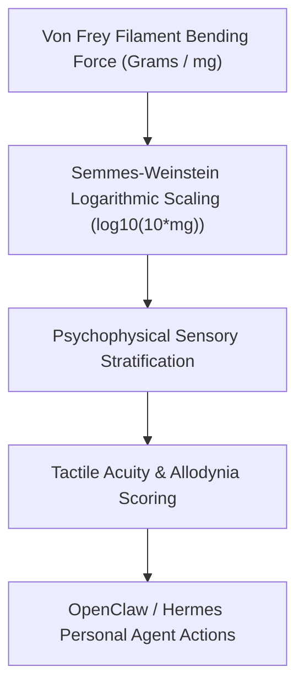

# Cutaneous Tactile Sensitivity & Mechanical Allodynia (Von Frey) Skill

[](LICENSE)
[](https://www.python.org/)
[](requirements.txt)
[](mcp_server.py)
[](SKILL.md)

Zero-dependency sovereign personal agent skill for non-invasive evaluation of cutaneous mechanoreceptive tactile thresholds via Von Frey Semmes-Weinstein monofilaments and mechanical allodynia detection.



## Features
- **Deterministic Math**: Pure Python standard library implementation with zero external dependencies.
- **Clinical Neuro-Psychophysical Standards**: Implements validated logarithmic force equations.
- **Sensory Blunting vs Allodynia Differentiation**: Accurately classifies peripheral neuropathy vs central pain sensitization.
- **Model Context Protocol (MCP)**: Native JSON-RPC tool integration for LLMs and autonomous agents.

## Quickstart

```python
from client import CutaneousTactileVonFreyClient

client = CutaneousTactileVonFreyClient()
result = client.evaluate_tactile_threshold(
    applied_force_grams=0.04,
    detection_reported=True
)
print("SW Marking:", result["semmes_weinstein_marking"])
print("Classification:", result["classification"])
```

## License
Apache-2.0
